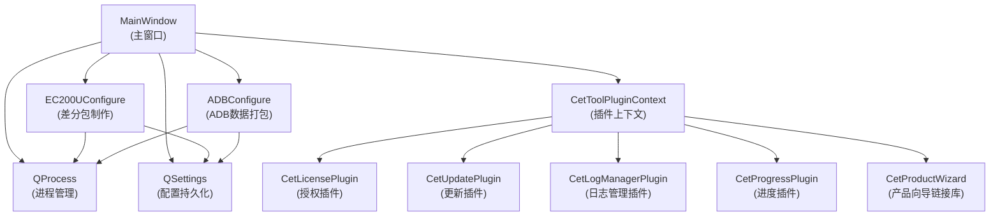

# CetDevelopmentKit 架构设计

## 一、项目概述

| 项目 | 说明 |
|---|---|
| 软件名称 | CetDevelopmentKit（Cet 开发集成工具包） |
| 当前版本 | V2.5.0 |
| 技术栈 | Qt 5.15.2 / C++11 / MinGW 32-bit / Windows |
| 作者 | CetXiyuan（笔名） |
| 官网 | https://www.cetxiyuan.com/ |

本工具是面向嵌入式/Android 设备开发的桌面端辅助工具，将多个命令行工具的操作封装为 GUI 界面，目前集成两大功能：**EC200U 差分包制作** 和 **ADB 设备数据打包导出**。

---

## 二、整体架构

CetDevelopmentKit 采用 **插件化架构**，核心应用通过 `CetToolPluginContext` 统一加载和管理外部插件 DLL，功能模块则以内联 QWidget 子类的形式静态编译到主程序中。

### 架构图

```
┌─────────────────────────────────────────────────────────┐
│                     MainWindow（主窗口）                  │
│                                                          │
│  ┌──────────────┐   ┌──────────────────────────────────┐ │
│  │  功能选择     │   │         功能配置面板               │ │
│  │ ComboBox     │──▶│  EC200UConfigure / ADBConfigure  │ │
│  └──────────────┘   └──────────────────────────────────┘ │
│                                                          │
│  ┌────────────────────────────────────────────────────┐  │
│  │           QProcess（共享进程实例）                    │  │
│  │   stdout/stderr → QPlainTextEdit（日志输出区）       │  │
│  └────────────────────────────────────────────────────┘  │
│                                                          │
│  ┌────────────────────────────────────────────────────┐  │
│  │      CetToolPluginContext（插件上下文管理器）         │  │
│  │  插件加载 / 完整性校验 / 激活时序 / 更新检测          │  │
│  └────────────────────────────────────────────────────┘  │
│                                                          │
│  菜单栏：[许可] [日志管理]                              │
└─────────────────────────────────────────────────────────┘
         │ CetToolPluginContext 统一管理
         ▼
┌─────────────────────────────────────────────────────────┐
│                      插件层（plugins/）                   │
│  CetLogManagerPlugin  CetLicensePlugin  CetUpdatePlugin  │
│  CetProgressPlugin                                       │
└─────────────────────────────────────────────────────────┘
         │ 动态链接（本地随附）
         ▼
┌─────────────────────────────────────────────────────────┐
│           动态库（CetProductWizard.dll，随程序目录部署）    │
└─────────────────────────────────────────────────────────┘
```

### 模块依赖关系



### 关键设计原则

1. **单进程复用**：全局唯一 `QProcess` 实例由 `MainWindow` 持有，各功能模块共享，切换功能时 `close()` 当前进程再复用。
2. **插件上下文封装**：所有插件通过 `CetToolPluginContext` 统一加载和管理，主窗口不再直接持有各插件接口指针，降低耦合度。
3. **配置即时持久化**：用户输入字段变更时立即写入 `QSettings` INI 文件，无需手动保存（个别仅用于当次任务且每次必变的字段如输出文件名除外）。
4. **HiDPI 自适应**：`main.cpp` 启动时启用 `AA_EnableHighDpiScaling` + `PassThrough` 舍入策略，确保高分辨率屏幕正确缩放。
5. **跨平台风格一致**：通过 `QStyleFactory::create(list.last())` 选取系统最终可用风格（通常为 Fusion），保证 UI 外观统一。
6. **插件完整性校验**：`CetToolPluginContext` 构造时通过 `selfIntegrityCheck()` 对 `CetProductWizard.dll` 做 SHA256 哈希校验，防止 DLL 被替换。

---

## 三、目录结构说明

```
CetDevelopmentKit/                  ← 仓库根目录
├── CetDevelopmentKit/              ← Qt 工程源码目录
│   ├── CetDevelopmentKit.pro       ← QMake 工程文件（主入口）
│   ├── CMakeLists.txt              ← CMake 构建文件
│   ├── main.cpp                    ← 程序入口
│   ├── version.h                   ← 全局版本号定义
│   ├── app.rc                      ← Windows 资源文件（图标/版本信息）
│   ├── interfaces/                 ← 插件接口定义（纯虚类 + Q_DECLARE_INTERFACE）
│   │   ├── cetlicenseinterface.h
│   │   ├── cetupdateinterface.h
│   │   ├── cetlogmanagerinterface.h
│   │   ├── cetprogressinterface.h
│   │   └── interfaces.pri
│   ├── mainwindow/                 ← 主窗口模块
│   │   ├── mainwindow.h / .cpp
│   │   ├── cettoolplugincontext.h  ← 插件上下文管理器（源码在 CetToolDLLs）
│   │   ├── mainwindow.ui
│   │   └── mainwindow.pri
│   ├── modules/                    ← 功能模块（每个子目录为一个工具模块）
│   │   ├── modules.pri
│   │   ├── ec200u/                 ← EC200U 差分包制作模块
│   │   │   ├── ec200uconfigure.h / .cpp
│   │   │   ├── ec200uconfigure.ui
│   │   │   └── ec200u.pri
│   │   └── adb/                    ← ADB 设备数据导出模块
│   │       ├── adbconfigure.h / .cpp
│   │       ├── adbconfigure.ui
│   │       └── adb.pri
│   ├── libs/
│   │   └── CetProductWizard.dll    ← 动态链接库（产品向导，编译时链接）
│   └── build/                      ← 构建输出目录（不入版本库）
├── CetDevelopmentKit-Release/      ← 发布运行目录
│   ├── CetDevelopmentKit.exe
│   ├── CetCommandLineTool.exe      ← 命令行工具（V2.0.0 起随附）
│   ├── CetProductWizard.dll
│   ├── plugins/                    ← 运行时插件目录
│   │   ├── CetLicensePlugin.dll
│   │   ├── CetUpdatePlugin.dll
│   │   ├── CetLogManagerPlugin.dll
│   │   ├── CetProgressPlugin.dll
│   │   └── CetPlugins.ini
│   ├── Qt5*.dll / lib*.dll         ← Qt 运行时依赖
│   └── LICENSE/                    ← 授权文件目录
├── CetDevelopmentKit-Setup/        ← 安装包工程
│   ├── CetDevelopmentKit.iss       ← Inno Setup 脚本
│   └── Output/                     ← 生成的安装包 .exe
└── CetDevelopmentKit-Patch/        ← 补丁包目录
```

---

## 四、模块划分与职责

### 4.1 主窗口模块（MainWindow）

**文件**：`mainwindow/mainwindow.h` / `mainwindow.cpp`

主窗口是整个应用的控制中枢，负责：

| 职责 | 实现方式 |
|---|---|
| 功能模块切换 | `QComboBox` 切换，`doCurrentIndexChanged()` 控制模块显示/隐藏 |
| 进程管理 | 唯一 `QProcess` 实例，`on_processHandleButton_clicked()` 启动 |
| 日志输出 | `QPlainTextEdit` 展示 stdout/stderr |
| 进度显示 | `QProgressBar`，由各模块 `emit progress(value)` 信号驱动 |
| 配置持久化 | `Configs/AppMaster.ini`，记录当前选中的功能索引 |
| 插件初始化 | 委托给 `CetToolPluginContext::initFeatures()` |

**功能切换逻辑**：

```
ComboBox 选择 → doCurrentIndexChanged()
    ├── 清空日志区
    ├── 隐藏所有功能配置面板
    ├── 显示对应功能面板（EC200UConfigure 或 ADBConfigure）
    └── 保存当前选中索引到 AppMaster.ini
```

**进程通信流程**：

```
点击执行按钮
    → 调用当前模块 startCommand() 获取命令行
    → QProcess::start(program, arguments)
    → readyReadStandardOutput → 追加到日志区 + 调用模块 recvHandle(data)
    → readyReadStandardError  → 追加到日志区
    → finished → 设置进度条 100%，关闭进程
```

### 4.2 CetToolPluginContext（插件上下文管理器）

**文件**：`mainwindow/cettoolplugincontext.h`（声明），实现位于 `CetToolDLLs/CetToolDLLs/`

`CetToolPluginContext` 是 V2.5.0 引入的插件管理中枢，将原先分散在 `MainWindow` 中的插件加载、激活时序、更新检测等逻辑集中封装。

**职责**：

| 职责 | 说明 |
|---|---|
| 插件加载 | 统一从指定路径加载 `.dll` 插件，支持完整性校验 |
| 完整性校验 | 构造时对 `CetProductWizard.dll` 做 SHA256 哈希校验 |
| 功能初始化 | `initFeatures()` 一次性完成所有插件的加载和激活时序设置 |
| 接口访问 | 通过 `logManager()`、`license()`、`updater()`、`progress()` 访问器获取插件接口 |

**接口访问器**：

| 方法 | 返回值 | 说明 |
|------|--------|------|
| `logManager()` | `CetLogManagerInterface*` | 日志管理插件接口 |
| `license()` | `CetLicenseInterface*` | 许可证插件接口 |
| `updater()` | `CetUpdateInterface*` | 更新检测插件接口 |
| `progress()` | `CetProgressInterface*` | 进度显示插件接口 |

### 4.3 EC200U 差分包制作模块

**文件**：`modules/ec200u/ec200uconfigure.h` / `ec200uconfigure.cpp`
**配置文件**：`Configs/EC200UConfigure.ini`（键组：`EC200UConfig`）

**功能**：调用移远 EC200U 官方工具（`fotacreate2` 命令）生成 OTA 差分升级包（`.pac` 格式）。

**用户配置项**：

| 配置项 | INI 键 | 说明 |
|---|---|---|
| 工具路径 | `toolPath` | 差分制作工具可执行文件路径 |
| 原固件包 | `oldPacket` | 旧版本固件 `.pac` 文件 |
| 新固件包 | `newPacket` | 新版本固件 `.pac` 文件 |
| 输出目录 | `outputDir` | 差分包输出目录（默认桌面） |
| 输出文件名 | 不持久化 | 输出文件名（默认 `output.pac`，因每次构建需不同文件名，故不保存到 INI） |

**生成的命令格式**：

```
<工具路径> fotacreate2 --pac <旧固件>,<新固件>,<工具目录>\setting\fota8910.xml <输出目录>\<输出文件名> -d v
```

**进度处理**：`recvHandle()` 收到任何输出即直接上报 100%（工具本身无结构化进度输出）。

### 4.4 ADB 设备数据打包导出模块

**文件**：`modules/adb/adbconfigure.h` / `adbconfigure.cpp`
**配置文件**：`Configs/ADBConfigure.ini`（键组：`ADBConfig`）

**功能**：通过 ADB shell 登入 Android 设备，将设备内指定路径打包为 `.tar.gz` 后拉取到本地。

**用户配置项**：

| 配置项 | INI 键 | 说明 |
|---|---|---|
| ADB 工具路径 | `toolPath` | `adb.exe` 路径 |
| 用户名 | `username` | 设备 shell 登录用户名 |
| 密码 | `password` | 设备 shell 登录密码 |
| 设备打包路径 | `packPath` | 设备内待打包的目录路径 |
| 本地输出目录 | `outputDir` | 拉取文件保存目录（默认桌面） |

**操作流程（状态机 `m_step`）**：

```
startCommand() → 执行 adb shell（启动交互式 Shell）
    ↓ 收到 "ogin"（匹配 "login" 或 "Login"）
    写入用户名
    ↓ 收到 "assword"（匹配 "password" 或 "Password"）→ progress(20%)
    写入密码
    ↓ 收到 "#"（Shell 就绪）
    step=0 → 执行 rm /tmp/cetmp*.tar.gz（清理历史）→ progress(45%)
    step=1 → 执行 tar -zcf /tmp/cetmp_<时间戳>.tar.gz <打包路径>/* → progress(65%)
    step=2 → 关闭 shell 连接 → progress(85%)
           → 延迟 1000ms → 执行 adb pull <设备临时包> <本地输出目录> → progress(100%)
```

> 关键设计：Shell 交互采用**输出关键词匹配**驱动状态机，通过 `QProcess::write()` 向 stdin 注入命令，模拟终端交互。
>
> **安全注意**：ADB 密码以明文形式存储在 `Configs/ADBConfigure.ini` 中，请确保运行环境访问可控。

### 4.5 插件接口层（interfaces/）

| 接口类 | 接口 DLL | 职责 |
|------|----------|------|
| `CetLicenseInterface` | `CetLicensePlugin.dll` | 产品授权激活（绑定产品固钥，支持 Ed25519 签名验证） |
| `CetUpdateInterface` | `CetUpdatePlugin.dll` | 在线更新检测（支持 2 位数版本号） |
| `CetLogManagerInterface` | `CetLogManagerPlugin.dll` | 日志管理窗口 |
| `CetProgressInterface` | `CetProgressPlugin.dll` | 进度显示插件 |

### 4.6 链接库（libs/）

| 文件 | 职责 |
|------|------|
| `CetProductWizard.dll` | 产品向导功能库，编译时隐式链接（`-lCetProductWizard`），运行时 SHA256 校验 |

---

## 五、插件系统

### 5.1 插件加载机制

插件加载由 `CetToolPluginContext` 统一管理，搜索优先级：

```
1. D:/Program Files (x86)/CetXiyuan/CetToolDLLs/plugins/   ← 开发/共享环境
2. ./plugins/                                                 ← 发布包随附目录
```

插件通过 Qt 插件机制（`QPluginLoader`）加载，须实现对应接口并标注 `Q_DECLARE_INTERFACE`。

### 5.2 接口清单

| 接口类 | IID | 对应插件 | 缺失行为 |
|---|---|---|---|
| `CetLicenseInterface` | `org.qter.plugin.CetLicenseInterface` | `CetLicensePlugin.dll` | 弹出警告，主界面禁用 |
| `CetUpdateInterface` | `org.qter.plugin.CetUpdateInterface` | `CetUpdatePlugin.dll` | 弹出警告，跳过更新检测 |
| `CetLogManagerInterface` | `org.qter.plugin.CetLogManagerInterface` | `CetLogManagerPlugin.dll` | 构造时加载，不显示警告 |
| `CetProgressInterface` | `org.qter.plugin.CetProgressInterface` | `CetProgressPlugin.dll` | 静默忽略 |

### 5.3 插件完整性校验

`CetToolPluginContext` 构造时执行自完整性检查：

- 对 `CetProductWizard.dll` 做 SHA256 哈希计算
- 与编译时嵌入的 `HASH_CetProductWizard_DLL`（定义在 `cettooldlls_hashes.h`）比对
- 校验失败则记录错误，防止 DLL 被替换或篡改

### 5.4 授权激活系统

激活以 `PRODUCT_NAME`（= `APP_NAME` + 主版本号 + 次版本号 + `"0"`，如 `CetDevelopmentKit250`）作为产品唯一标识，绑定设备固钥（`solidKey()`）。

**V2.5.0 许可 3.0 新特性**：
- **Ed25519 签名验证**：许可文件采用 Ed25519 算法签名，公钥内嵌于 `CetLicensePlugin.dll`
- **SHA256 校验**：插件自身支持 SHA256 完整性校验
- **临时授权**：支持临时授权模式
- **停用/拒绝状态**：授权被停用或拒绝后自动停止重试

**自动激活时序**：

```
程序启动
    └─ 10秒后 → 首次自动激活
         ├─ 激活成功：主界面启用，标题栏恢复正常
         ├─ 激活失败：主界面禁用，标题栏显示到期信息和固钥
         └─ 30分钟后 → 再次激活（间隔时间每次翻倍：30→60→120→...分钟）
              └─ 若授权被拒绝 → 停止重试

用户手动激活：菜单栏 → [许可] → [激活]（弹出激活窗口）
```

---

## 六、版本号系统

版本号在 `version.h` 中集中管理，两种模式：

| 宏 | 正式版（IS_RELEASE_VERSION=1） | 补丁版（IS_RELEASE_VERSION=0） |
|---|---|---|
| `APP_VERSION` | `2.5.0` | `2.5.0.7152` |
| `TIP_VERSION` | `(CXYQK5152.CDPK250.G716)` | `(CXYQK5152.CDPK250.G716) Patch-7152` |
| `PRODUCT_NAME` | `CetDevelopmentKit250` | `CetDevelopmentKit250` |

**版本编码说明**（以 `CXYQK5152.CDPK250.G716` 为例）：

| 段 | 含义 |
|---|---|
| `CXYQK5152` | CetXiyuan Qt Kernel 5.15.2（Qt 版本） |
| `CDPK250` | CetDevelopmentKit 第 250 次构建 |
| `G716` | G=2026年（A=2020年起），7=7月，16编码为 16−7(月)=9 即 9日 |

---

## 七、核心类/组件

### 7.1 MainWindow（主窗口）

**职责**：应用程序核心控制器，管理所有子模块、进程生命周期，委托 `CetToolPluginContext` 处理插件管理。

**重要方法**：

| 方法 | 说明 |
|------|------|
| `MainWindow(QWidget *parent)` | 构造函数，初始化 CetToolPluginContext、QSettings、UI、子模块、信号/槽连接 |
| `~MainWindow()` | 析构函数，清理 QProcess 和 UI |
| `doCurrentIndexChanged(int index)` | 切换功能模块（EC200U / ADB），保存选择状态到 QSettings |

**重要信号/槽**：

| 信号/槽 | 触发时机 | 说明 |
|---------|---------|------|
| `onProcessFinished(int, QProcess::ExitStatus)` | QProcess 结束时 | 正常退出时置进度条 100%，关闭进程 |
| `on_processHandleButton_clicked()` | 点击"执行"按钮 | 关闭当前进程，根据当前模块生成命令并启动新进程 |
| `on_processConfigureButton_clicked()` | 点击"配置"按钮 | 折叠/展开配置面板 |
| lambda: readyReadStandardOutput | 进程有标准输出时 | 读取数据 → 显示到日志区 → 路由到当前模块的 recvHandle() |
| lambda: readyReadStandardError | 进程有标准错误时 | 读取数据 → 显示到日志区 |

**关键属性**：

| 属性 | 类型 | 说明 |
|------|------|------|
| `m_toolPluginCtx` | `CetToolPluginContext* const` | 插件上下文管理器（统一管理所有插件） |
| `m_cmdProcess` | `QProcess* const` | 共享进程实例，所有模块共用 |
| `m_settings` | `QSettings* const` | 应用全局配置（`Configs/AppMaster.ini`） |
| `m_ec200uConfigure` | `EC200UConfigure*` | EC200U 功能模块实例 |
| `m_adbConfigure` | `ADBConfigure*` | ADB 功能模块实例 |

### 7.2 CetToolPluginContext（插件上下文管理器）

**职责**：统一管理所有插件的加载、完整性校验、激活时序和更新检测。

**重要方法**：

| 方法 | 说明 |
|------|------|
| `CetToolPluginContext(const QString &selfHash, QWidget *parent)` | 构造函数，执行自完整性校验 |
| `initFeatures(logManagerMenu, licenseMenu, productName, versionTitle, appName, appVersion, onActivated)` | 初始化所有功能插件并设置激活时序 |
| `loadPlugin(const QString &dllName, QString *errInfo)` | 带完整性校验的插件加载，返回 QObject 指针 |
| `logManager()` | 获取日志管理插件接口 |
| `license()` | 获取许可证插件接口 |
| `updater()` | 获取更新检测插件接口 |
| `progress()` | 获取进度显示插件接口 |

### 7.3 EC200UConfigure（EC200U 差分包制作）

**职责**：配置 EC200U 模块的 OTA 差分升级包制作参数，构造并验证命令行。

**重要方法**：

| 方法 | 返回值 | 说明 |
|------|--------|------|
| `startCommand()` | `QString` | 验证工具路径、原/新固件包路径有效性，构造 `fotacreate2` 命令行 |
| `recvHandle(const QByteArray &data)` | `void` | 接收进程输出，直接发送 progress(100) 信号 |

**信号**：

| 信号 | 触发时机 |
|------|---------|
| `progress(int value)` | recvHandle() 被调用时，发送 100（表示完成） |

**槽**：

| 槽 | 触发时机 |
|----|---------|
| `on_toolPathButton_clicked()` | 浏览工具路径 |
| `on_oldPacketButton_clicked()` | 浏览原固件包 |
| `on_newPacketButton_clicked()` | 浏览新固件包 |
| `on_outputDirButton_clicked()` | 浏览输出目录 |

### 7.4 ADBConfigure（ADB 设备数据打包导出）

**职责**：通过 ADB Shell 交互式会话，实现设备数据打包并拉取到本地。

**重要方法**：

| 方法 | 返回值 | 说明 |
|------|--------|------|
| `startCommand()` | `QString` | 验证 ADB 工具路径，返回 `"<工具路径>" shell` 命令，初始化 m_step=0 |
| `recvHandle(const QByteArray &data)` | `void` | 状态机驱动的 Shell 交互处理（见下文数据流） |

**信号**：

| 信号 | 触发时机 |
|------|---------|
| `progress(int value)` | 各步骤完成时，值分别为 20/45/65/85/100 |

**关键属性**：

| 属性 | 类型 | 说明 |
|------|------|------|
| `m_step` | `int` | 状态机步骤号（0-2），-1 表示流程结束 |

### 7.5 CetLicenseInterface（许可证接口）

**职责**：定义产品授权激活的抽象契约。

**枚举**：

| 值 | 说明 |
|----|------|
| `ACTIVATE_CANCEL` (0) | 激活取消 |
| `ACTIVATE_OK` (1) | 激活成功 |
| `ACTIVATE_ER` (2) | 激活失败 |

**纯虚方法**：

| 方法 | 说明 |
|------|------|
| `initialize(const QString &productId)` | 通过产品 ID 初始化激活环境 |
| `activate()` | 非窗口式激活（后台自动激活） |
| `activateWindow()` | 窗口式激活（用户手动激活） |
| `resultString()` | 获取激活结果描述 |
| `solidKey()` | 获取产品固钥 |

### 7.6 CetUpdateInterface（更新检测接口）

**纯虚方法**：

| 方法 | 说明 |
|------|------|
| `checkUpdate(const QString &appName, const QString &appVersion, callback_t callback)` | 检测服务器是否有新版本，可选回调 |
| `inUpdating(QString &newVersion)` | 查询是否正在更新中 |

---

## 八、关键数据流

### 场景一：EC200U 差分包制作

```
用户点击[执行]按钮
    │
    ▼
on_processHandleButton_clicked()
    │
    ├─ m_cmdProcess->close()          // 关闭上次进程
    ├─ m_ec200uConfigure->startCommand()
    │   ├─ 验证 toolPath 存在
    │   ├─ 验证 oldPacket 存在
    │   ├─ 验证 newPacket 存在
    │   └─ 构造命令: "toolPath fotacreate2 --pac old,new,setting\fota8910.xml outputDir\output.pac -d v"
    ├─ QProcess::splitCommand(command) // 分割命令和参数
    ├─ m_cmdProcess->start(program, arguments)
    │
    ▼
进程输出 → readyReadStandardOutput 信号
    │
    ├─ ui->plainTextEdit->appendPlainText(data)   // 显示原始输出
    └─ m_ec200uConfigure->recvHandle(data)
        └─ emit progress(100)                     // 更新进度条
    │
    ▼
进程结束 → onProcessFinished()
    └─ ui->progressBar->setValue(100)
```

### 场景二：ADB 设备数据打包导出

```
用户点击[执行]按钮
    │
    ▼
on_processHandleButton_clicked()
    ├─ m_cmdProcess->close()
    ├─ m_adbConfigure->startCommand()
    │   └─ 返回 "adb shell" + 设置 m_step = 0
    ├─ m_cmdProcess->start("adb", ["shell"])
    │
    ▼
Shell 交互（状态机，由 recvHandle 驱动）
    │
    ├─ 收到 "ogin" → 发送用户名
    ├─ 收到 "assword" → 发送密码 → progress(20)
    ├─ 收到 "#" →
    │   ├─ step 0: 发送 "rm /tmp/cetmp*.tar.gz" → progress(45)
    │   ├─ step 1: 发送 "tar -zcf /tmp/cetmp_xxx.tar.gz path/*" → progress(65)
    │   └─ step 2: close() → 1秒后启动 adb pull → progress(85→100)
    │
    ▼
adb pull 完成 → onProcessFinished()
    └─ ui->progressBar->setValue(100)
```

### 场景三：插件加载与许可证激活时序

```
应用启动
    │
    ▼
MainWindow 构造函数
    ├─ 创建 CetToolPluginContext(HASH_CetProductWizard_DLL)
    │   └─ selfIntegrityCheck()：SHA256 校验 CetProductWizard.dll
    ├─ 创建 QSettings、QProcess
    ├─ 初始化 UI、子模块
    │
    ▼
m_toolPluginCtx->initFeatures()
    ├─ 加载 CetLogManagerPlugin.dll
    ├─ 加载 CetLicensePlugin.dll → initialize(PRODUCT_NAME)
    ├─ 加载 CetUpdatePlugin.dll → checkUpdate()
    ├─ 加载 CetProgressPlugin.dll
    │
    ▼
激活时序（由 CetToolPluginContext 内部管理）
    ├─ 首次激活：10 秒后
    │   ├─ 成功 → 启用 centralWidget，更新标题
    │   ├─ 失败/取消 → 禁用 centralWidget，显示到期信息
    │   └─ 被拒绝 → 停止后续重试
    └─ 重试：30 分钟 → 60 分钟 → 120 分钟 → ... (指数退避)
```

---

## 九、依赖关系

### 外部依赖

| 依赖 | 版本 | 用途 |
|------|------|------|
| Qt | 5.15.2 | 核心框架 |
| MinGW | 32-bit | 编译器 |
| CetProductWizard | (链接库) | 产品向导功能 |
| CetToolDLLs | (源码库) | CetToolPluginContext 实现及插件工程 |
| Inno Setup | 6.x | 安装包制作 |
| fotacreate2 | EC200U 工具链 | 差分包生成 |
| adb | Android SDK | 设备通信 |

### Qt 模块

| 模块 | 用途 |
|------|------|
| Qt5::Core | 核心功能（事件循环、QProcess、QTimer、QSettings） |
| Qt5::Gui | GUI 基础（高 DPI 缩放） |
| Qt5::Widgets | 窗口组件（QMainWindow、QComboBox、QProgressBar 等） |
| Qt5::Network | 网络通信（供更新/许可插件使用） |

### 内部模块依赖

```
main.cpp
  └── MainWindow
        ├── CetToolPluginContext (插件上下文管理器)
        │     ├── CetLicenseInterface → CetLicensePlugin.dll
        │     ├── CetUpdateInterface → CetUpdatePlugin.dll
        │     ├── CetLogManagerInterface → CetLogManagerPlugin.dll
        │     └── CetProgressInterface → CetProgressPlugin.dll
        ├── modules/ec200u/ (静态编译)
        │     └── EC200UConfigure
        ├── modules/adb/ (静态编译)
        │     └── ADBConfigure
        └── libs/CetProductWizard.dll (隐式链接 + 运行时 SHA256 校验)
```

---

## 十、配置文件汇总

所有配置文件均为 INI 格式，存放于程序运行目录下的 `Configs/` 子目录：

| 文件 | QSettings 键组 | 持久化内容 |
|---|---|---|
| `Configs/AppMaster.ini` | `CETDKITConfig` | 当前选中功能索引（`processIndex`） |
| `Configs/EC200UConfigure.ini` | `EC200UConfig` | 工具路径、原/新固件包路径、输出目录 |
| `Configs/ADBConfigure.ini` | `ADBConfig` | ADB工具路径、用户名、密码、打包路径、输出目录 |

---

## 十一、设计决策与取舍

### 1. 插件化 vs 静态编译

**决策**：核心功能模块（EC200U、ADB）采用静态编译，许可证/更新/日志等基础设施采用插件化。

**理由**：
- 核心功能模块与主程序耦合度高，静态编译可减少 DLL 依赖，简化部署
- 许可证/更新等基础设施需要独立版本迭代，插件化允许在不重新编译主程序的情况下更新这些组件
- 插件接口简洁（纯虚类），降低了跨版本兼容性风险

### 2. 共享 QProcess vs 独立进程

**决策**：所有功能模块共享同一个 `QProcess` 实例。

**理由**：
- 同一时间只能执行一个功能任务（UI 设计上通过 ComboBox 切换）
- 共享进程简化了生命周期管理和信号连接
- 避免了多进程并发的资源竞争问题

**代价**：切换任务时必须先关闭当前进程（`m_cmdProcess->close()`），无法保留上一次任务的输出。

### 3. 指数退避激活策略

**决策**：激活失败后采用指数退避重试（30 分钟 → 60 分钟 → 120 分钟 → ...），被拒绝则完全停止。

**理由**：
- 避免短时间频繁请求对服务器造成压力
- 首次激活 10 秒延迟，给系统启动留出缓冲时间
- 指数增长确保长期未激活时不会过于频繁地重试
- 拒绝状态停止重试，避免无效请求

### 4. QMake 优先，CMake 兼容

**决策**：以 QMake 为主要构建系统，同时维护 CMakeLists.txt 作为备选。

**理由**：
- QMake 与 Qt Creator 集成更紧密，开发者体验更好
- CMake 是跨平台标准，为未来可能的平台扩展预留空间
- 两种构建系统共享同一套源代码，无需维护两套文件结构

### 5. ADB 交互使用文本匹配状态机

**决策**：ADB Shell 交互通过简单的文本关键字匹配（"ogin"、"assword"、"#"）驱动状态机。

**理由**：
- ADB Shell 输出格式相对固定，简单文本匹配足够可靠
- 避免了引入复杂的正则表达式或终端模拟库
- 代码清晰，维护成本低

**代价**：如果 ADB 输出格式变化（如中文提示），匹配逻辑需要同步更新。

### 6. 插件上下文封装（V2.5.0）

**决策**：将插件加载和管理逻辑从 `MainWindow` 迁移到独立的 `CetToolPluginContext` 类。

**理由**：
- 降低 MainWindow 的复杂度，单一职责原则
- 插件管理逻辑可在多个工具间复用（CetToolDLLs 共享）
- 便于独立维护和测试插件管理功能
- 支持完整性校验，防止 DLL 被替换

---

## 十二、扩展点

| 扩展点 | 说明 | 修改方式 |
|--------|------|---------|
| 新增功能模块 | 在 `modules/` 下新增子目录，实现 QWidget 子类 | 添加 `.pri` 文件，在 `modules.pri` 中 include，在 `MainWindow` 中注册 |
| 新增插件类型 | 在 `interfaces/` 下新增纯虚接口 | 定义接口类，添加 `Q_DECLARE_INTERFACE` 宏，在 `CetToolPluginContext` 中加载 |
| 新增配置项 | 在各模块的 INI 配置文件组中增加键值 | 使用 `QSettings` 的 `beginGroup/endGroup` 模式 |
| 扩展 ADB 状态机 | 增加新的 Shell 交互步骤 | 在 `ADBConfigure::recvHandle()` 的 switch 中添加新 case |
| 支持更多构建套件 | 当前仅支持 MinGW 32-bit | 修改 `.pro` 文件的条件编译宏，添加对应套件的库路径 |
| 国际化 | 当前使用 `tr()` 但仅支持中文 | 添加 `.ts` 翻译文件，使用 Qt Linguist 工具链 |
| 插件完整性 | 当前仅校验 CetProductWizard.dll | 扩展 `selfIntegrityCheck()` 支持校验其他 DLL |
